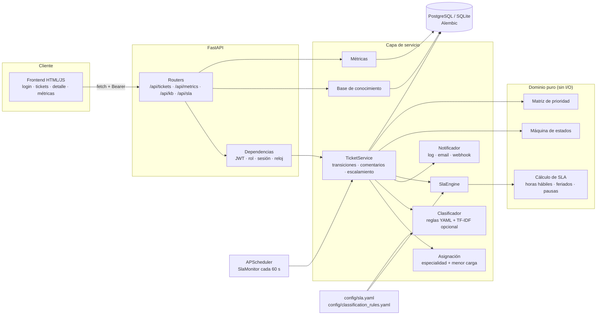
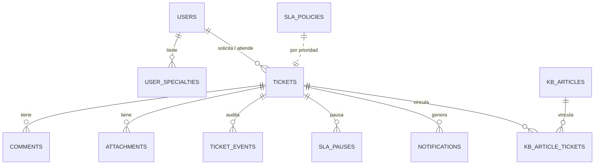
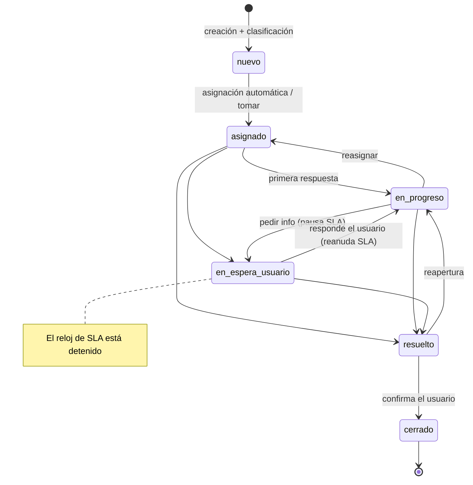

# Mesa de Ayuda con SLA y escalamiento N1 → N2 → N3

Sistema de tickets de soporte técnico pensado como lo usaría un equipo de mesa de ayuda real:
prioridad calculada con la matriz impacto × urgencia de ITIL, SLA medido en **horario hábil
argentino** (con feriados y pausas), escalamiento automático entre niveles cuando el SLA se
incumple, asignación por especialidad y carga, auditoría completa de cada cambio y un dashboard
con las métricas que se miran en una reunión de operaciones (MTTA, MTTR, % SLA, FCR, backlog).

 

**Stack:** FastAPI · SQLAlchemy 2.0 · Alembic · PostgreSQL (SQLite en desarrollo y tests) ·
APScheduler · PyJWT · scikit-learn (opcional) · HTML + JS sin build con Chart.js · pytest · ruff ·
Docker · GitHub Actions

---

## Índice

- [Qué resuelve](#qué-resuelve)
- [Arquitectura](#arquitectura)
- [Ciclo de vida del ticket](#ciclo-de-vida-del-ticket)
- [Prioridad y políticas de SLA](#prioridad-y-políticas-de-sla)
- [Reglas de escalamiento](#reglas-de-escalamiento)
- [Asignación automática](#asignación-automática)
- [Clasificación automática](#clasificación-automática)
- [Roles y permisos](#roles-y-permisos)
- [Endpoints](#endpoints)
- [Métricas](#métricas)
- [Cómo correrlo](#cómo-correrlo)
- [Usuarios de demo](#usuarios-de-demo)
- [Tests y calidad](#tests-y-calidad)
- [Decisiones de diseño y limitaciones](#decisiones-de-diseño-y-limitaciones)

## Qué resuelve

| Problema típico de una mesa de ayuda | Cómo lo resuelve el sistema |
|---|---|
| "¿Este ticket es urgente?" depende de quién lo mire | Prioridad P1–P4 calculada con la matriz impacto × urgencia |
| El SLA corre de noche, fines de semana y feriados | Reloj en horario hábil (lun–vie 9–18, feriados de Argentina configurables) |
| El reloj sigue corriendo mientras esperamos al usuario | El estado `en_espera_usuario` pausa el SLA y la respuesta del usuario lo reanuda |
| Los tickets se "duermen" en N1 | Job cada minuto: aviso al 75% y escalamiento automático al incumplir |
| Siempre le cae todo al mismo agente | Asignación por especialidad + menor carga con desempate round-robin |
| Nadie sabe quién cambió qué | `ticket_events`: auditoría de cada cambio de estado, nivel, prioridad, asignación |
| Se resuelve lo mismo una y otra vez | Base de conocimiento vinculada a tickets resueltos y sugerida al crear |

## Arquitectura



- **Dominio puro** (`app/domain/`): máquina de estados, matriz de prioridad y aritmética de SLA.
  No conoce la base ni HTTP, por eso se testea con cientos de casos sin fixtures.
- **Servicios** (`app/services/`): todos los cambios pasan por `TicketService`, que valida la
  transición, registra el evento de auditoría y recalcula los vencimientos.
- **Reloj inyectable** (`app/clock.py`): la API, el job y los tests usan el mismo `Clock`. En los
  tests se usa `FrozenClock` y se "adelanta el tiempo" sin `sleep`.
- **Notificaciones pluggables**: cada aviso queda en la bandeja interna (`notifications`) y además
  sale por los canales de `NOTIFIERS` (`log`, `email`, `webhook`). Un canal caído no corta el flujo.

### Modelo de datos



## Ciclo de vida del ticket



Reglas que se validan en la capa de servicio (`app/domain/state_machine.py`):

- Cualquier transición fuera del diagrama devuelve **409** (`Transición no permitida: nuevo → cerrado`).
- Para pasar a `resuelto` es obligatorio describir la solución (mínimo 10 caracteres).
- El solicitante solo puede **cerrar** o **reabrir** su propio ticket resuelto.
- La **primera respuesta** se registra con el primer comentario público de un agente o al pasar a
  `en_progreso` / `en_espera_usuario` / `resuelto`. Las notas internas no cuentan.
- Si el solicitante comenta mientras el ticket está `en_espera_usuario`, vuelve solo a `en_progreso`.
- El escalamiento/desescalamiento "reencola" el ticket: queda `asignado` al nuevo agente o `nuevo`
  si no hay nadie disponible en ese nivel.

## Prioridad y políticas de SLA

Prioridad según impacto × urgencia (ITIL):

| Impacto \ Urgencia | Alta | Media | Baja |
|---|---|---|---|
| **Alto** (área completa, clientes) | P1 | P2 | P3 |
| **Medio** (un equipo) | P2 | P3 | P4 |
| **Bajo** (un usuario) | P3 | P4 | P4 |

Políticas por defecto (`config/sla.yaml`, editables también vía `PUT /api/sla/policies/{prioridad}`):

| Prioridad | Descripción | Primera respuesta | Resolución | Calendario |
|---|---|---|---|---|
| **P1** | Crítico, servicio caído para muchos usuarios | 15 min | 4 h | 24x7 |
| **P2** | Alto, degradación importante | 30 min | 8 h hábiles (1 jornada) | Hábil |
| **P3** | Medio, un usuario con alternativa | 4 h hábiles | 27 h hábiles (3 jornadas) | Hábil |
| **P4** | Bajo, consultas y pedidos | 8 h hábiles | 45 h hábiles (5 jornadas) | Hábil |

Calendario hábil:

- Lunes a viernes de 9:00 a 18:00, zona `America/Argentina/Buenos_Aires`.
- Feriados nacionales 2025–2026 cargados en el YAML (lista editable, verificar cada año).
- El tiempo en `en_espera_usuario` no consume SLA. Las pausas se guardan como intervalos
  (`sla_pauses`) y el vencimiento se corre exactamente lo que duró la pausa **en horas hábiles**.

Ejemplos que están cubiertos por tests (`tests/test_sla_calculation.py`):

| Inicio | Objetivo | Vence | Por qué |
|---|---|---|---|
| Mié 11/03 10:00 | 2 h | Mié 12:00 | Mismo día |
| Mié 11/03 17:00 | 2 h | Jue 10:00 | Queda 1 h el miércoles y 1 h el jueves |
| Vie 13/03 17:00 | 2 h | Lun 16/03 10:00 | Salta el fin de semana |
| Vie 20/03 17:00 | 2 h | Mié 25/03 10:00 | Salta fin de semana + feriados 23 y 24/03 |
| Sáb 14/03 15:00 | 30 min | Lun 16/03 9:30 | Arranca en la próxima apertura |
| Mié 10:00, pausa 11:00–14:00 | 4 h | Mié 17:00 | La pausa corre el vencimiento 3 h |

Estados del SLA que ve el frontend (badge con cuenta regresiva):

| Estado | Color | Condición |
|---|---|---|
| `en_curso` | 🟢 verde | menos del 75% consumido |
| `advertencia` | 🟡 amarillo | 75% o más consumido |
| `incumplido` | 🔴 rojo | se superó el objetivo |
| `pausado` | ⚪ gris | esperando al usuario |
| `cumplido` | ⚪ gris | objetivo alcanzado a tiempo |

## Reglas de escalamiento

El job `SlaMonitor` (`app/services/escalation.py`) corre cada minuto con APScheduler y también se
puede disparar a mano con `POST /api/sla/check`.

| Situación | Acción |
|---|---|
| Primera respuesta o resolución llega al **75%** | Evento `sla_advertencia` + notificación al asignado (o a todo el nivel si no hay asignado) |
| **Incumple la primera respuesta** | Evento `sla_incumplido`, sube un nivel (N1→N2→N3) y se reasigna al agente de menor carga con la especialidad |
| **Incumple la resolución** | Igual que arriba |
| Ya está en **N3** | No se puede escalar: alerta a supervisión |
| Dos incumplimientos en la misma corrida | Escala una sola vez; el segundo avisa a supervisión |
| Ticket **P1** | Supervisión recibe aviso inmediato al crearse y en cada escalamiento o incumplimiento |
| Ticket pausado (`en_espera_usuario`) | No se evalúa como incumplido mientras está pausado |

Cada advertencia/incumplimiento se notifica una sola vez (banderas en el ticket), así una corrida
cada minuto no genera spam.

**Escalamiento manual:** `POST /api/tickets/{id}/escalate` y `/deescalate` con **motivo obligatorio**
(mínimo 10 caracteres). Escalan agentes del nivel actual y supervisión; desescalan N2/N3 y
supervisión. El motivo queda en la auditoría.

## Asignación automática

`app/services/assignment.py`

1. Se buscan agentes activos del nivel del ticket **con la especialidad** (redes, windows, linux,
   bases_de_datos, aplicaciones). Si no hay especialista, se usa cualquier agente del nivel.
2. Gana el de **menor cantidad de tickets abiertos**.
3. Empate: el que hace más tiempo que no recibe un ticket (**round-robin**), y luego el id menor.
4. En un escalamiento se excluye a quien escaló, salvo que sea el único disponible.

## Clasificación automática

Al crear un ticket se sugiere categoría, especialidad y nivel inicial:

1. **Reglas** en `config/classification_rules.yaml`: regex sobre título y descripción normalizados
   (minúsculas, sin tildes). Cada coincidencia suma 1 punto y 2 si está en el título; gana la regla
   con más puntos. Ejemplos: `VPN`, `FortiClient` → redes/N1 · `DNS`, `no resuelve` → redes/N2 ·
   `contraseña`, `bloqueado` → blanqueo de contraseña/N1 · `postgres`, `deadlock` → bases de datos/N2.
2. **Modelo opcional** TF-IDF + LogisticRegression entrenado en memoria con `data/sample_tickets.csv`.
   Solo se usa si ninguna regla coincide y si scikit-learn está instalado (`requirements-ml.txt`).
   Sin scikit-learn el sistema funciona igual, solo con reglas.
3. Si nada coincide: `otro / aplicaciones / N1`.

La vista previa está disponible en `POST /api/classify` (el formulario la muestra mientras se escribe)
junto con los artículos de la base de conocimiento sugeridos.

## Roles y permisos

| Acción | Solicitante | Agente N1/N2/N3 | Supervisor |
|---|---|---|---|
| Crear ticket | ✅ | ✅ | ✅ |
| Ver tickets | Solo los propios | Los de su nivel + asignados a él | Todos |
| Comentario público | En sus tickets | ✅ | ✅ |
| Nota interna | ❌ (tampoco las ve) | ✅ | ✅ |
| Cambiar estado | Cerrar/reabrir su ticket resuelto | Tickets de su cola | ✅ |
| Escalar | ❌ | ✅ | ✅ |
| Desescalar | ❌ | N2 y N3 | ✅ |
| Métricas | ❌ | ✅ | ✅ |
| Usuarios y políticas de SLA | ❌ | ❌ | ✅ |

Un ticket que el usuario no puede ver devuelve **404** (no 403) para no revelar su existencia.

## Endpoints

Documentación interactiva en `/docs` (Swagger) y `/redoc`.

| Método | Ruta | Descripción |
|---|---|---|
| POST | `/api/auth/login` | Login (form `username`/`password`), devuelve JWT |
| GET | `/api/auth/me` | Usuario autenticado |
| GET / POST | `/api/users` | Listar / crear usuarios (supervisor) |
| GET | `/api/users/agents` | Agentes activos (para reasignar) |
| POST | `/api/tickets` | Crear ticket (devuelve clasificación y artículos sugeridos) |
| GET | `/api/tickets` | Listar con filtros: `status`, `priority`, `level`, `assignee_id`, `mine`, `open_only`, `q`, `sla`, `limit`, `offset` |
| GET | `/api/tickets/{id}` | Detalle con SLA, comentarios, adjuntos, timeline y transiciones permitidas |
| PATCH | `/api/tickets/{id}` | Cambiar impacto/urgencia (recalcula prioridad y SLA), categoría, especialidad |
| POST | `/api/tickets/{id}/transition` | Cambio de estado (`status`, `note`, `resolution`) |
| POST | `/api/tickets/{id}/assign` | Reasignación manual dentro del nivel |
| POST | `/api/tickets/{id}/escalate` | Escalar con motivo obligatorio |
| POST | `/api/tickets/{id}/deescalate` | Desescalar con motivo obligatorio |
| POST | `/api/tickets/{id}/comments` | Comentario público o nota interna |
| POST | `/api/tickets/{id}/attachments` | Adjunto (multipart, se guardan metadatos y SHA-256) |
| GET | `/api/tickets/{id}/events` | Auditoría del ticket |
| POST | `/api/classify` | Vista previa de clasificación + prioridad + artículos |
| GET | `/api/sla/policies` | Políticas vigentes |
| PUT | `/api/sla/policies/{prioridad}` | Editar política (supervisor) |
| POST | `/api/sla/check` | Ejecutar el chequeo de SLA ahora (supervisor) |
| GET | `/api/metrics/overview` | Todas las métricas (`from`, `to` opcionales) |
| GET | `/api/metrics/sla-compliance` | Cumplimiento por `group_by=priority\|level\|agent` |
| GET | `/api/metrics/backlog` | Backlog por nivel, prioridad y estado |
| GET / POST | `/api/kb/articles` | Artículos de la base de conocimiento |
| GET | `/api/kb/articles/{id}` | Detalle de artículo |
| POST | `/api/kb/articles/{id}/tickets` | Vincular un ticket resuelto |
| GET | `/api/kb/suggest?q=` | Sugerencias por palabras clave |
| GET | `/api/notifications` | Bandeja de notificaciones del usuario |
| POST | `/api/notifications/{id}/read` | Marcar como leída |
| GET | `/health` | Salud de la API y la base |

Ejemplo rápido con `curl`:

```bash
TOKEN=$(curl -s -X POST localhost:8000/api/auth/login \
  -d "username=ana.perez@example.com&password=Demo1234!" | jq -r .access_token)

curl -s -X POST localhost:8000/api/tickets -H "Authorization: Bearer $TOKEN" \
  -H "Content-Type: application/json" \
  -d '{"title":"La VPN no conecta","description":"FortiClient queda en 98%","impact":"medio","urgency":"alta"}' \
  | jq '.ticket | {id, priority, level, status, assignee: .assignee.full_name}'
```

## Métricas

Calculadas en `app/services/metrics.py` y visibles en el dashboard (`#/dashboard`).

| Métrica | Definición |
|---|---|
| **MTTA** (Mean Time To Acknowledge) | Promedio de minutos entre la creación y la primera respuesta |
| **MTTR** (Mean Time To Resolve) | Promedio de horas entre la creación y la resolución |
| **% SLA de resolución** | Tickets resueltos dentro del objetivo / tickets resueltos |
| **% SLA de respuesta** | Primeras respuestas dentro del objetivo / tickets con respuesta |
| **% SLA por prioridad / nivel / agente** | Igual que arriba, agrupado por prioridad, nivel donde se resolvió o agente que resolvió |
| **FCR** (resolución en primer contacto) | Tickets resueltos en N1 sin ningún escalamiento / tickets resueltos |
| **Tasa de escalamiento** | Tickets escalados al menos una vez / total de tickets |
| **Backlog** | Tickets abiertos por nivel, prioridad y estado; vencidos y sin asignar |
| **Volumen semanal** | Tickets creados vs. resueltos por semana |

MTTA y MTTR se miden en tiempo calendario (lo que percibe el usuario). El cumplimiento de SLA usa
el calendario de cada política (hábil o 24x7).

## Cómo correrlo

### Opción 1: Docker (API + PostgreSQL + datos de demo)

```bash
docker compose up --build
# http://localhost:8000      frontend
# http://localhost:8000/docs Swagger
```

Al arrancar el contenedor se aplican las migraciones y se cargan los datos de demo si la base está vacía.

### Opción 2: local con SQLite

Requiere Python 3.11 o superior.

```bash
python -m venv .venv
# Linux/macOS
source .venv/bin/activate
# Windows (PowerShell)
.venv\Scripts\Activate.ps1

pip install -r requirements-dev.txt
pip install -r requirements-ml.txt   # opcional: clasificador TF-IDF

cp .env.example .env                 # opcional, por defecto usa ./helpdesk.db
alembic upgrade head
python -m app.seed                   # usuarios, políticas, artículos y ~200 tickets
uvicorn app.main:app --reload
```

Con `make` instalado: `make install`, `make seed`, `make run`, `make check`.

El seed genera tickets de los últimos 90 días pasando por la misma capa de servicio que usa la
API, con un reloj simulado. Así cada ticket tiene su auditoría completa (asignaciones, pausas,
escalamientos con motivo, resolución y cierre) y las métricas del dashboard son coherentes.
Al final ejecuta una corrida real del job de SLA sobre los tickets abiertos.
Para recargar desde cero: `python -m app.seed --reset`.

## Usuarios de demo

Contraseña para todos: `Demo1234!` (en la pantalla de login se puede hacer clic en el email para completarlo).

| Rol | Email | Especialidades |
|---|---|---|
| Supervisor | `supervisor@example.com` | — |
| Agente N1 | `n1.martin@example.com` | windows, aplicaciones |
| Agente N1 | `n1.carla@example.com` | redes, windows |
| Agente N1 | `n1.diego@example.com` | aplicaciones, linux |
| Agente N2 | `n2.sofia@example.com` | redes |
| Agente N2 | `n2.pablo@example.com` | linux, bases_de_datos |
| Agente N2 | `n2.valeria@example.com` | windows, aplicaciones |
| Agente N3 | `n3.javier@example.com` | redes, linux |
| Agente N3 | `n3.lucia@example.com` | bases_de_datos, aplicaciones, windows |
| Solicitante | `ana.perez@example.com`, `jorge.lopez@example.com`, `marta.diaz@example.com`, … | — |

Recorrido sugerido:

1. Entrar como `ana.perez@example.com` y crear un ticket "No puedo entrar, usuario bloqueado".
   Mirar la clasificación sugerida y el artículo recomendado mientras se escribe.
2. Entrar como `n1.martin@example.com`, abrir el ticket, comentar y pasarlo a "En espera del
   usuario": el badge de SLA queda en gris (pausado).
3. Como Ana, responder el comentario: el ticket vuelve solo a "En progreso" y el SLA se reanuda.
4. Como N1, escalarlo con un motivo y ver en la auditoría el cambio de nivel y la reasignación.
5. Entrar como `supervisor@example.com` y revisar el dashboard de métricas.

## Tests y calidad

```bash
pytest                                  # 170 tests
pytest --cov=app --cov-report=term-missing
ruff check . && ruff format --check .
```

| Archivo | Qué cubre |
|---|---|
| `test_sla_calculation.py` | Horas hábiles: mismo día, noche, fin de semana, feriados, zona horaria, pausas superpuestas, pausa abierta, vencimiento corrido, umbral de advertencia, propiedad ida y vuelta `add`/`business_seconds` con datos aleatorios |
| `test_domain.py` | Matriz de prioridad completa y transiciones permitidas/prohibidas |
| `test_assignment_and_classification.py` | Especialidad, menor carga, round-robin, inactivos; reglas, tildes, peso del título, modelo ML |
| `test_ticket_service.py` | Alta, auditoría, pausas, reapertura, primera respuesta, escalamiento/desescalamiento, P1 |
| `test_escalation_job.py` | Job con `FrozenClock`: advertencia una sola vez, escalamiento por incumplimiento, fin de semana, pausa, N3 → supervisión |
| `test_api.py` | Flujos HTTP completos con `TestClient`, vencimiento de JWT, visibilidad por rol, filtros, KB, métricas |
| `test_metrics.py` | MTTA, MTTR, % SLA, FCR, tasa de escalamiento y backlog con datos controlados |
| `test_notifications.py` | Canales log/email/webhook y tolerancia a fallas |
| `test_migrations_and_seed.py` | La migración inicial coincide con los modelos, downgrade, seed consistente |

CI (`.github/workflows/ci.yml`): ruff, tests en Python 3.11/3.12/3.13, `alembic upgrade head` +
seed + downgrade contra un PostgreSQL de servicio, y `docker build`.

## Decisiones de diseño y limitaciones

- **SLA desde la creación del ticket, no por nivel.** El escalamiento no reinicia el reloj: el
  usuario sigue esperando lo mismo aunque el ticket cambie de manos.
- **P1 en 24x7.** Un incidente crítico no espera al lunes; el resto usa horario hábil.
- **Escalamiento por incumplimiento, como máximo uno por corrida.** Evita que un ticket viejo
  salte de N1 a N3 en un solo minuto.
- **Fechas en UTC en la base** (`UTCDateTime` guarda sin zona y devuelve aware), conversión a hora
  argentina solo para el cálculo hábil y la UI. Mismo comportamiento en SQLite y PostgreSQL.
- **Enums como VARCHAR** (no tipos nativos de PostgreSQL) para que las migraciones sean portables.
- **Contraseñas con PBKDF2-SHA256** de la librería estándar (sin dependencias nativas).
- **El vencimiento de JWT se valida contra el reloj inyectado**, así los tests con tiempo
  congelado se comportan igual que en producción.
- **Adjuntos:** se guardan metadatos (nombre, tipo, tamaño, SHA-256); el archivo iría a un
  almacenamiento de objetos (S3/MinIO), fuera del alcance de la demo.
- **Métricas calculadas en Python** sobre los tickets filtrados: simple y portable para miles de
  tickets. Con mucho volumen convendría agregarlas en SQL o en una tabla de hechos.
- **El scheduler corre dentro del proceso de la API.** Con varias réplicas habría que moverlo a un
  worker único (o usar un lock en la base) para no duplicar avisos.
- **Feriados:** la lista 2025–2026 es configurable y hay que mantenerla cada año (incluye los días
  no laborables con fines turísticos).
- **El modelo de ML es didáctico**: con ~70 ejemplos sirve para mostrar el flujo de respaldo, no
  para producción. Las reglas son la fuente principal y se pueden ajustar sin tocar código.
